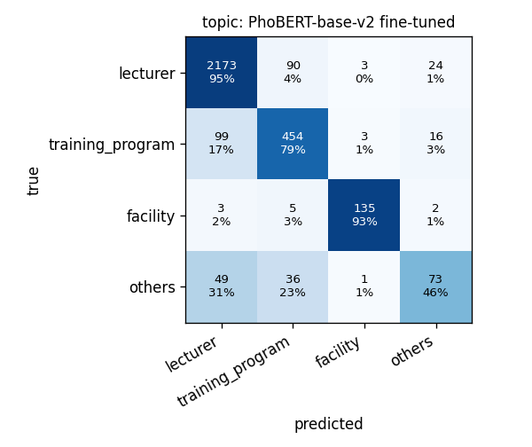
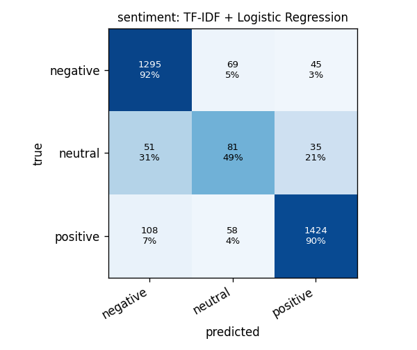

# Evaluation report

UIT-VSFC test set: 3166 feedback sentences. OOD set: 1300 texts (1000 banking-news sentences, 300 e-commerce product titles), normalised the same way as the training text.

## Task: topic (4 classes)

| Model | Accuracy | Macro-F1 | Weighted-F1 | p50 latency (1 text) | p95 | Batch throughput |
|---|---|---|---|---|---|---|
| PhoBERT-base-v2 fine-tuned | 0.8955 | 0.8001 | 0.8929 | 82.6 ms | 109.4 ms | 15 texts/s |
| TF-IDF + linear SVM (calibrated) | 0.8689 | 0.7502 | 0.8629 | 8.4 ms | 11.2 ms | 4038 texts/s |
| TF-IDF + Logistic Regression | 0.8639 | 0.7416 | 0.8591 | 3.1 ms | 4.5 ms | 4746 texts/s |

Per-class precision / recall / F1, best model (PhoBERT-base-v2 fine-tuned):

| Class | Support | Precision | Recall | F1 |
|---|---|---|---|---|
| lecturer | 2290 | 0.935 | 0.949 | 0.942 |
| training_program | 572 | 0.776 | 0.794 | 0.785 |
| facility | 145 | 0.951 | 0.931 | 0.941 |
| others | 159 | 0.635 | 0.459 | 0.533 |

Human-review policy (threshold chosen on validation for ≥95% accuracy on auto-routed items):

| Model | Threshold | Auto-routed share (test) | Accuracy of auto-routed | OOD AUROC | OOD FPR@95TPR | OOD texts auto-routed |
|---|---|---|---|---|---|---|
| TF-IDF + Logistic Regression | 0.750 | 76.1% | 94.3% | 0.887 | 60.9% | 14.1% (news 16%, product titles 6%) |
| TF-IDF + linear SVM (calibrated) | 0.725 | 77.4% | 94.4% | 0.884 | 64.1% | 16.5% (news 18%, product titles 12%) |
| PhoBERT-base-v2 fine-tuned | 0.885 | 85.0% | 95.1% | 0.956 | 27.2% | 8.8% (news 4%, product titles 26%) |

Most confident errors (PhoBERT-base-v2 fine-tuned): these pass the threshold and reach the wrong team.

| Text | True | Predicted | Confidence |
|---|---|---|---|
| cô nhiệt tình , giảng bài hiệu quả . | training_program | lecturer | 0.99 |
| cô nhiệt tình , dạy có tâm . | training_program | lecturer | 0.99 |
| cô rất tận tình trong việc củng cố kiến thức . | training_program | lecturer | 0.99 |
| cô thường xuyên bổ trợ kiến thức cho sinh viên về các kỹ năng nghe , nói đọc viết . | training_program | lecturer | 0.99 |
| dạy rất chi tiết . | training_program | lecturer | 0.99 |
| cô vui tính , học không áp lực . | training_program | lecturer | 0.99 |
| cách diễn đạt của giảng viên chưa hiệu quả . | training_program | lecturer | 0.99 |
| dạy tương đối đầy đủ chương trình . | training_program | lecturer | 0.99 |
| có phần thầy nói hơi nhanh . | training_program | lecturer | 0.99 |
| dạy kỹ các phần quan trọng . | training_program | lecturer | 0.99 |
| sửa bài tập khó , giảng viên nhiệt tình . | others | lecturer | 0.99 |
| tỉ mỉ . | others | lecturer | 0.99 |

## Task: sentiment (3 classes)

| Model | Accuracy | Macro-F1 | Weighted-F1 | p50 latency (1 text) | p95 | Batch throughput |
|---|---|---|---|---|---|---|
| TF-IDF + Logistic Regression | 0.8844 | 0.7524 | 0.8877 | 3.5 ms | 5.3 ms | 3924 texts/s |
| TF-IDF + linear SVM (calibrated) | 0.8980 | 0.7174 | 0.8874 | 9.6 ms | 13.9 ms | 4010 texts/s |

Per-class precision / recall / F1, best model (TF-IDF + Logistic Regression):

| Class | Support | Precision | Recall | F1 |
|---|---|---|---|---|
| negative | 1409 | 0.891 | 0.919 | 0.905 |
| neutral | 167 | 0.389 | 0.485 | 0.432 |
| positive | 1590 | 0.947 | 0.896 | 0.920 |

Human-review policy (threshold chosen on validation for ≥95% accuracy on auto-routed items):

| Model | Threshold | Auto-routed share (test) | Accuracy of auto-routed | 
|---|---|---|---|
| TF-IDF + Logistic Regression | 0.735 | 80.2% | 94.5% |
| TF-IDF + linear SVM (calibrated) | 0.650 | 91.2% | 93.3% |

## Task: NER (ViEcomNER, 24 entity types, span-level, exact match)

| Model | Micro-F1 | Macro-F1 |
|---|---|---|
| CRF (hand-crafted features) | 0.5013 | 0.4916 |

Ten most frequent entity types, CRF (hand-crafted features):

| Entity | Support | Precision | Recall | F1 |
|---|---|---|---|---|
| PRODUCT_TYPE | 440 | 0.532 | 0.470 | 0.499 |
| COMPAT | 161 | 0.667 | 0.596 | 0.630 |
| BRAND | 160 | 0.644 | 0.644 | 0.644 |
| ATTRIBUTE | 145 | 0.308 | 0.303 | 0.306 |
| STYLE | 145 | 0.340 | 0.221 | 0.268 |
| MODEL | 126 | 0.486 | 0.548 | 0.515 |
| TARGET_GROUP | 119 | 0.845 | 0.689 | 0.759 |
| EFFECT | 117 | 0.557 | 0.419 | 0.478 |
| MATERIAL | 78 | 0.537 | 0.372 | 0.439 |
| SIZE | 72 | 0.603 | 0.486 | 0.538 |
